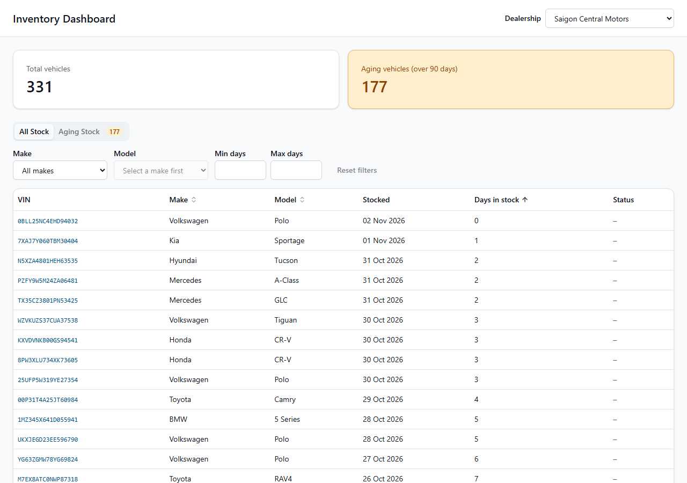
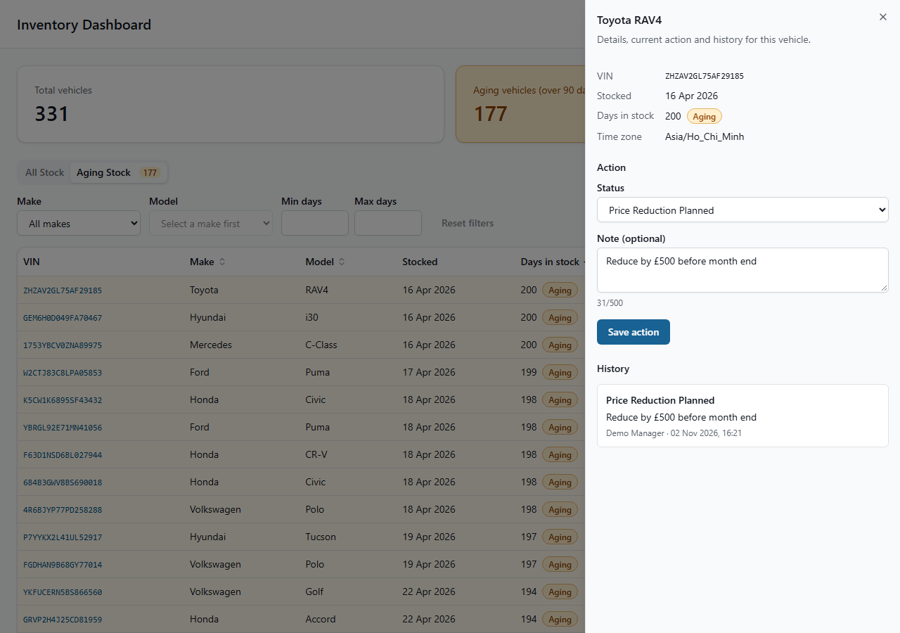

# Intelligent Inventory Dashboard

Keyloop Technical Assessment, Scenario B (Supply). A dashboard that lets a dealership manager see vehicle stock, spot cars in stock for more than 90 days, and record a decision on each one.

The **frontend is fully built**. The backend is mocked with [MSW](https://mswjs.io), which follows the API contract in the design, so replacing it with a real API needs no change to application code.

- **Architecture and decisions:** [SYSTEM_DESIGN.md](SYSTEM_DESIGN.md)
- **Delivery plan:** [PLAN.md](PLAN.md)
- **Phase-by-phase AI log:** [docs/ai-log.md](docs/ai-log.md)



## What it does

| Requirement             | How it works                                                                                                                                                                                         |
| ----------------------- | ---------------------------------------------------------------------------------------------------------------------------------------------------------------------------------------------------- |
| **Inventory list**      | Filter by make, model (depends on make) and days in stock. Sorting and paging happen on the server. All state is in the URL, so views can be shared and survive a reload.                            |
| **Aging stock**         | Vehicles over 90 days get a badge, a tinted row, a highlighted summary card and their own tab, oldest first. Age is calculated by the API on the dealership's local calendar, never the browser.     |
| **Actionable insights** | Log a status and optional note on an aging vehicle. Saves appear immediately and roll back on failure. A version check catches two managers editing the same car. Every change is kept in a history. |



## Getting started

You need Node.js 22.12 or later.

```bash
npm install
npm run dev
```

Open <http://localhost:5173>. The mock API starts automatically, and there is nothing else to run.

## Scripts

| Script               | Purpose                                                 |
| -------------------- | ------------------------------------------------------- |
| `npm run dev`        | Dev server with the mock API                            |
| `npm test`           | Run the test suite once                                 |
| `npm run test:watch` | Run the tests in watch mode                             |
| `npm run lint`       | ESLint and Prettier checks                              |
| `npm run typecheck`  | TypeScript checks                                       |
| `npm run build`      | Production build, without the mock (expects a real API) |
| `npm run build:demo` | Production build with the mock included                 |
| `npm run preview`    | Serve the latest build                                  |

To try a built version with data, run `npm run build:demo`, then `npm run preview`.

## Testing

`npm test` runs the suite with Vitest and React Testing Library. CI runs lint, typecheck, tests and a build on every pull request.

| Layer          | What is covered                                                                                                                               |
| -------------- | --------------------------------------------------------------------------------------------------------------------------------------------- |
| Business rules | Day 90 versus day 91, local midnight in several time zones, 23-hour and 25-hour daylight-saving days                                          |
| Mock API       | Filters, sorting, paging, validation and the 400, 404 and 409 responses, called through the real API client                                   |
| User behaviour | The whole app rendered against the mock handlers: filters and URL state, aging view, saving, validation, rollback, conflicts and keyboard use |
| Observability  | Request ids, log format and the error boundary                                                                                                |

## Demo scenarios

| Scenario             | How to reproduce                                                                                                                                                      |
| -------------------- | --------------------------------------------------------------------------------------------------------------------------------------------------------------------- |
| Failed page load     | Open `/?mockError=500`, then use **Try again**                                                                                                                        |
| Failed save          | Open `/?mockError=500&mockErrorOn=PUT`, then save an action on an aging vehicle. It appears, rolls back and a message explains why                                    |
| Version conflict     | Open the same aging vehicle in two tabs. In tab B, change the status **without saving**. In tab A, change it and save. Back in tab B, save: "Updated by someone else" |
| Different time zones | Use the dealership picker. The three dealerships are in Ho Chi Minh City, London and New York                                                                         |
| Clear saved actions  | Remove `inventory-dashboard.mock-actions.v1` from localStorage                                                                                                        |

## About the mock

- It generates 1,000 vehicles from a fixed seed. Stocking dates are relative to today, so the demo always has a spread of 0 to 200 days.
- Actions and history are saved in localStorage. Vehicles come from the seed.
- Responses take 200 to 600 ms, to simulate a network.
- Actions are recorded as "Demo Manager", because authentication is out of scope.
- The mock is loaded on demand and is left out of `npm run build`.

## Project structure

```
src/
  api/          Typed fetch client, endpoints and query keys
  components/   Shared UI (shadcn/ui in components/ui)
  features/
    inventory/  Summary, tabs, filters, table, paging and URL state
    vehicle/    Side panel, action form and history
  domain/       Types, statuses and the aging calculation
  hooks/        Data fetching and the optimistic save
  lib/          Logger, web vitals, URL state and formatting
  mocks/        MSW seed, database, handlers and error injection
  test/         Test setup, fixtures and render helpers
```

## Observability

- **Logs:** structured JSON through one logger in `src/lib/logger.ts`. `setLogSink` is the single place to connect a service such as Sentry.
- **Errors:** an error boundary and global handlers catch unexpected failures, and API failures are logged with their request id.
- **Metrics:** web vitals (CLS, FCP, INP, LCP, TTFB) are logged as `web_vital` entries.
- **Tracing:** every API call sends a unique `X-Request-Id`, to link a UI error to backend logs.

## AI Collaboration Narrative

### Strategy

I treated the AI as a fast engineer working to a specification I own. I used Claude for research and design, then Claude Code for implementation.

1. **Design first.** I chose the scenario and shaped the design with Claude, cutting what the brief did not need. [SYSTEM_DESIGN.md](SYSTEM_DESIGN.md) records those decisions.
2. **Written rules.** [PLAN.md](PLAN.md) set the source of truth, one branch and pull request per phase, and a ban on inventing business rules.
3. **Check before coding.** I had the agent compare the brief with the design and plan before writing code. That added the missing response shapes, a maintainability note and an explicit "no authentication" assumption.

### Verifying the output

I did not accept the AI's work because it looked right. Each phase had to pass independent checks:

- **Automated gates:** lint, strict typecheck, tests and a build, locally and in CI.
- **Tests on the rules that matter most:** the 90-day boundary, time zones, daylight saving, optimistic rollback and version conflicts.
- **A real browser:** jsdom cannot run a service worker, so scripted Chromium runs exercised the real mock, two real tabs and the built bundle.
- **Accessibility tooling:** an axe audit and a keyboard-only run.
- **The [AI log](docs/ai-log.md):** what was asked, kept, changed and how it was verified, per phase.

### What verification caught

| Problem                                                                                                                     | How it was found         | Resolution                                                                                 |
| --------------------------------------------------------------------------------------------------------------------------- | ------------------------ | ------------------------------------------------------------------------------------------ |
| The planned two-tab conflict could never fire, because refetch on focus gave the second tab the new version before it saved | Reasoning about the plan | An edited form keeps the version it started from. Tested, and confirmed with two real tabs |
| `?mockError=500` was used up by the first request on page load, so a failed save could not be demonstrated                  | Reasoning about the plan | Added `&mockErrorOn=PUT`                                                                   |
| Closing the panel sent keyboard focus to the top of the page                                                                | A failing test           | Focus returns to the row that opened the panel                                             |
| The summary cards had invalid list markup                                                                                   | axe audit                | Replaced the markup                                                                        |
| The shadcn CLI generated a broken import, and newer library versions had incompatible APIs or dependency conflicts          | Typecheck and CI         | Corrected the import and pinned compatible versions                                        |

### What went wrong

The AI merged Phase 4 while CI was failing, because a retry command did not make the merge conditional on the result. `main` was broken for a short time. CI showed the problem straight away: a dependency conflict that only failed on a clean CI install, and then a test timing assumption that only failed on a slower machine. Both were diagnosed from the logs and fixed through a pull request that merged only after CI passed.

The lesson I took from this is that a gate only works if nothing can get past it, and that includes the agent's own shortcuts.

### Ownership

To keep delivery moving, I had the agent merge each phase once its checks passed, and I review the combined result as the final gate. Automated checks and real-browser runs covered each phase; judgement on the final code and design is mine.
