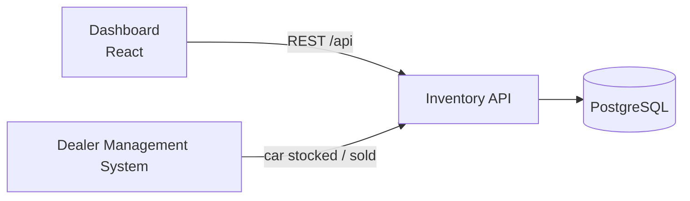
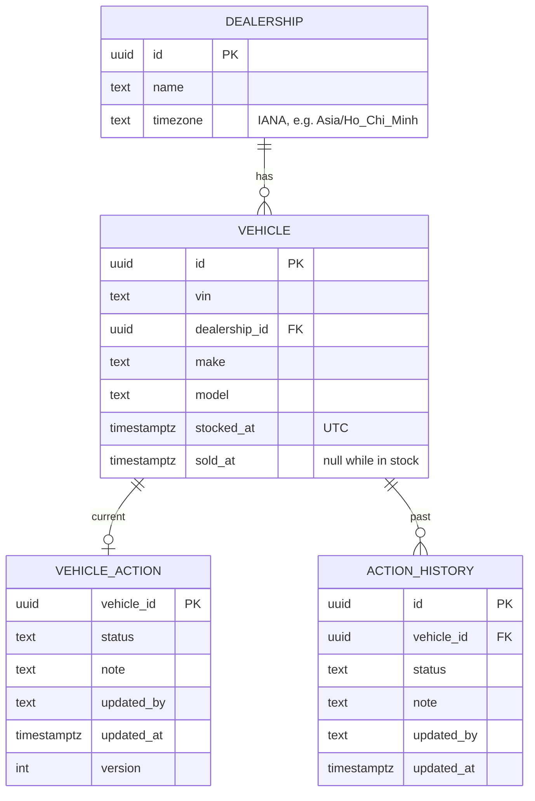

# System Design – Intelligent Inventory Dashboard

Keyloop Technical Assessment · Scenario B (Supply) · Implemented layer: **Frontend**

---

## 1. Overview

A dashboard that lets a dealership manager **see** vehicle stock, **spot** cars in stock for more than 90 days, and **record** a decision on each one.

Unsold cars cost a dealership money every day (Keyloop estimates around £25 per vehicle per day, [source](https://keyloop.com/blog/retailers/what-is-a-vehicle-inventory-management-system)), so managers review stock by days in stock and decide what to do with slow cars.

| Scope | |
|---|---|
| Built | Frontend covering all three requirements |
| Designed, mocked | Backend API and database (MSW mock following the API contract in §6) |
| Out of scope | Adding, editing or removing vehicles – inventory is owned by the Dealer Management System (DMS). Authentication – the brief does not ask for it, so the mock API records actions under one fixed user |

---

## 2. Requirements and assumptions

| # | Requirement (brief) | Assumption |
|---|---|---|
| R1 | Filterable list of a dealership's vehicles (make, model, age) | "Age" = days in stock |
| R2 | Identify and prominently show aging stock (> 90 days) | Day 0 = date the car entered stock; aging = day 91 onward, in the dealership's time zone |
| R3 | Log and persist a status/action for each aging vehicle | Fixed status list + optional note; every change kept in history (who, when) |

- **Statuses:** Price Reduction Planned, Send to Auction, Transfer to Another Site, No Action Yet.
- An action only records a decision; it does not change the vehicle. Sold vehicles leave the list.
- **"Real-time"** = refresh every 60 s and on tab focus. Stock changes a few times a day, so WebSockets are not needed.

---

## 3. Architecture



| Component | Role | In this submission |
|---|---|---|
| Dashboard | Displays stock, aging view, action form. No business rules – shows what the API returns | Built |
| Inventory API | Filters and pages vehicles, calculates aging, saves actions, receives car updates from the DMS | Mocked with MSW |
| PostgreSQL | Vehicles, current actions, action history | In-memory seed data + localStorage |
| DMS | Source of vehicle data | Replaced by generated seed data |

The mock follows the same API contract, so replacing it with the real backend needs no frontend change.

---

## 4. Data flow

- **R1 – Browse:** Dashboard sends filters and page to `GET /vehicles`; the API filters, sorts and pages in the database and returns one page with `daysInStock` per vehicle.
- **R2 – Aging:** same endpoint with `agingOnly=true`, oldest first; `GET /vehicles/summary` feeds the counts. Aging is calculated by the API, never by the browser.
- **R3 – Action:** Dashboard sends `PUT /vehicles/{id}/action` with the version it last saw. The API checks the version, saves the action and a history row in one transaction, and returns `200` or `409` if someone changed it first.
- **Inventory sync:** the DMS calls the API when a car is stocked or sold; the API inserts or updates that vehicle.

---

## 5. Data model



`daysInStock` and `isAging` are calculated, not stored, so they never go stale. Indexes on `(dealership_id, stocked_at)` and `(dealership_id, make, model)` support the filters.

---

## 6. API contract

Base path `/api`, JSON, UTC ISO 8601 timestamps. Errors: `{ "error": { "code", "message" } }`.

| Endpoint | Purpose | Errors |
|---|---|---|
| `GET /dealerships` | Dealership picker | – |
| `GET /vehicles?dealershipId&make&model&minDays&maxDays&agingOnly&sort&page&pageSize` | Filtered, paged list | 400 |
| `GET /vehicles/filter-options?dealershipId` | Make → model dropdown values | 400 |
| `GET /vehicles/summary?dealershipId` | Total and aging counts | 400 |
| `GET /vehicles/{id}` | Detail, current action (with version), history | 404 |
| `PUT /vehicles/{id}/action` — `{ status, note, version }` | Save an action | 400 not aging / invalid, 404, 409 version conflict |

Example list item:

```json
{
  "id": "v1", "vin": "1HGCM82633A004352", "make": "Toyota", "model": "Camry",
  "stockedAt": "2026-08-01T01:00:00Z", "daysInStock": 93, "isAging": true,
  "currentAction": { "status": "PRICE_REDUCTION_PLANNED", "updatedAt": "2026-11-01T03:00:00Z", "updatedBy": "Anna" }
}
```

Response shapes (`currentAction` is `null` until the first action is saved):

| Endpoint | Response |
|---|---|
| `GET /dealerships` | `{ items: [{ id, name, timezone }] }` |
| `GET /vehicles` | `{ items, page, pageSize, total }` |
| `GET /vehicles/filter-options` | `{ makes: [{ make, models: [] }] }` |
| `GET /vehicles/summary` | `{ total, aging }` |
| `GET /vehicles/{id}` | List item fields, with `currentAction` adding `note` and `version`, plus `history` (newest first) |
| `PUT /vehicles/{id}/action` | `200 { currentAction }`; `409 { error, currentAction }` with the latest action |

---

## 7. Key design decisions

| Problem | Decision | Rejected alternative |
|---|---|---|
| Large stock lists | Filter, sort, page in the database | Load all vehicles into the browser |
| Aging must stay correct | Calculate from `stocked_at` in each query | Nightly job storing a flag – stale between runs |
| Two managers edit the same vehicle | Version check (optimistic locking) → `409` | Row locks – overkill for rare clashes |
| Status shown but save failed | Optimistic UI update with rollback | Wait for the server before showing anything – feels slow |
| Who decided what | Current action + history, saved together | Overwrite only – no audit trail |
| Freshness | Polling 60 s + refetch on focus | WebSocket – unnecessary for slow-changing data |

**Time zones.** Days in stock depends on when "today" starts, and dealer groups can span time zones.

1. Store timestamps in UTC; store each dealership's IANA time zone (handles daylight saving).
2. Count days by the dealership's local calendar date, not the server's.
3. Use the same calculation for filtering and display, so a car shown as day 91 always appears in the aging filter.
4. Show dates in the dealership's time zone.

---

## 8. Technology choices

| Area | Choice | Why |
|---|---|---|
| Frontend | React + TypeScript + Vite | Typed API contract, fast tooling |
| Server state | TanStack Query | Caching, polling, optimistic updates with rollback |
| Table | TanStack Table | Server-side paging and sorting |
| UI | shadcn/ui + Tailwind | Accessible components, easy to adjust |
| Forms | React Hook Form + Zod | Typed validation |
| Dates | date-fns-tz | IANA time zone support |
| Mock API | MSW | Intercepts real `fetch`, so UI code is unchanged with a real backend; reused in tests |
| Tests | Vitest + React Testing Library | Fast, tests behaviour as the user sees it |
| Backend (designed) | Node.js + PostgreSQL | Same language as the frontend; transactions and time zone support |

---

## 9. Non-functional

- **Scalability:** the API is stateless, so more instances can run behind a load balancer when needed.
- **Performance:** server-side paging (max 100 per page), indexes, debounced filter inputs, cached queries.
- **Reliability:** action and history saved in one transaction; clear loading, empty and error states with retry in the UI.
- **Maintainability:** typed API contract in one client, code grouped by feature, business rules kept in pure tested functions, CI runs lint, typecheck and tests on every pull request.

---

## 10. Observability

| | Backend (designed) | Frontend (built) |
|---|---|---|
| Logs | Structured JSON with request ID | Central logger, error boundary; Sentry-ready |
| Metrics | Request rate, latency, error rate per endpoint | Web vitals, API errors seen by users |
| Tracing | OpenTelemetry, API → database | `X-Request-Id` header on every call, to link UI errors with backend logs |

---

## 11. Delivery

Code is delivered in phases, each as a reviewed pull request. Phases are listed in `PLAN.md`.

---

## 12. Use of GenAI in the design phase

I used Claude as a research and design partner; I made and checked the decisions.

- **Scenario choice:** compared all four scenarios for a frontend build and design depth, then chose B.
- **Grounded assumptions:** when the AI's list of open questions was too speculative, I had it research Keyloop's products so assumptions matched the real business.
- **Kept scope to the brief:** rejected extra features and fields the AI suggested; kept action history because the brief says "log".
- **Simplified the architecture:** the AI's first architecture had a gateway, message broker and monitoring stack. I cut it to what the requirements need.
- **Added what it missed:** the AI suggested dropping time zones; I kept them as a real design concern.
- **Verified:** checked each decision against the brief's wording and Keyloop's published material.
